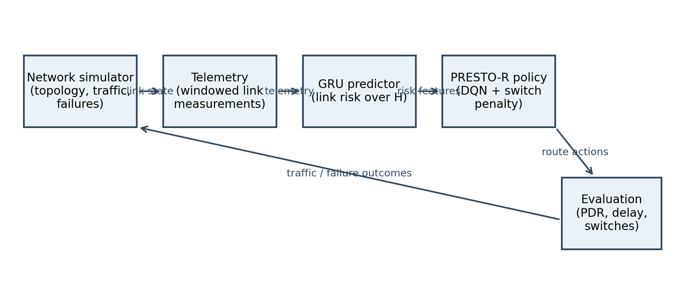
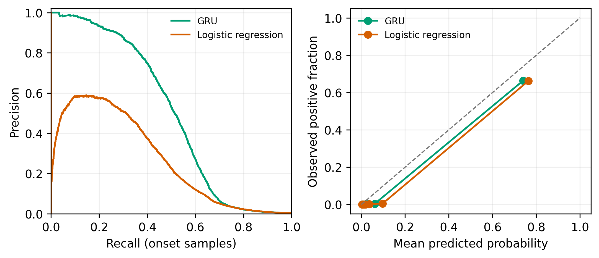
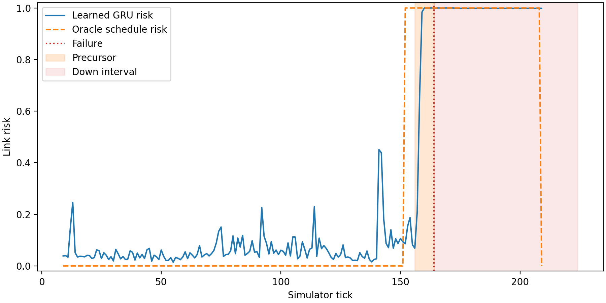
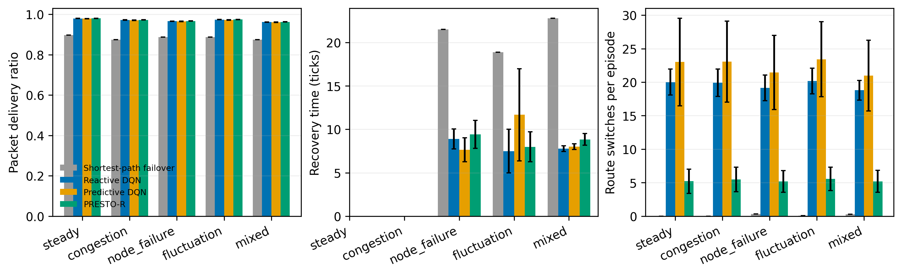
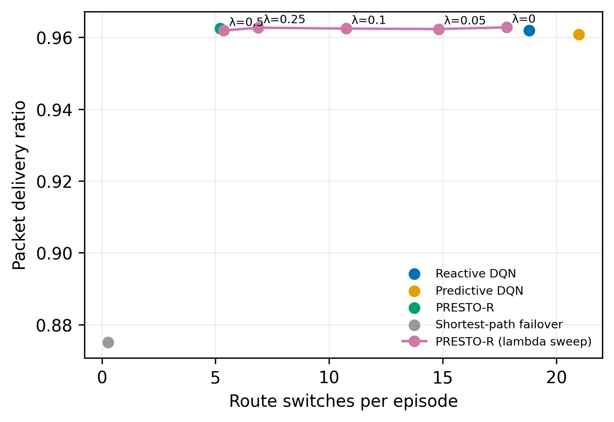
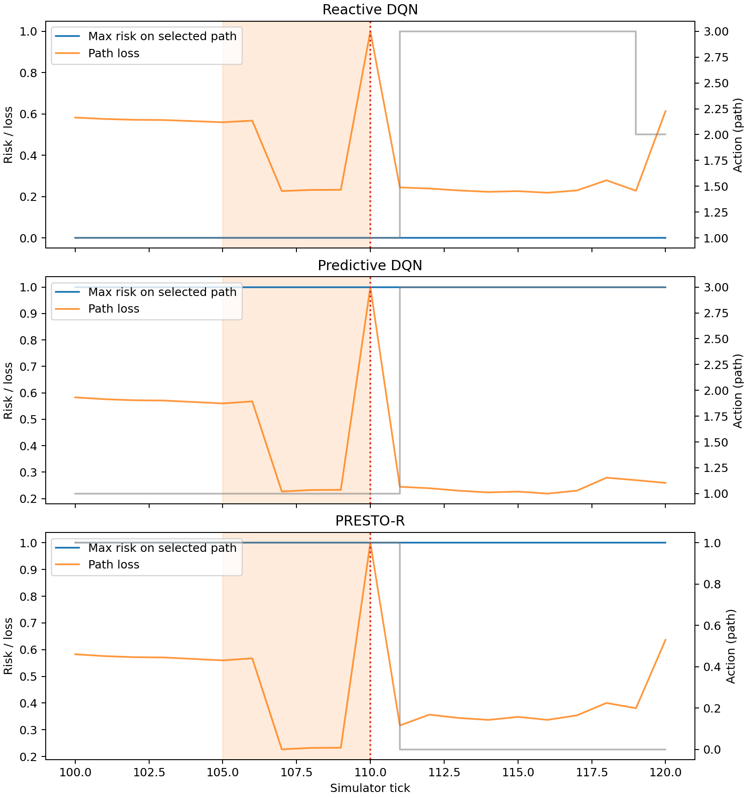
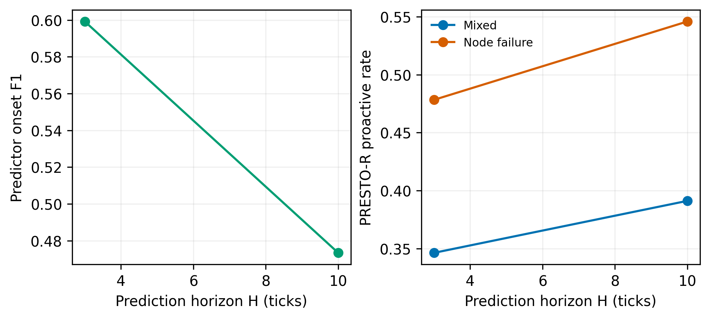
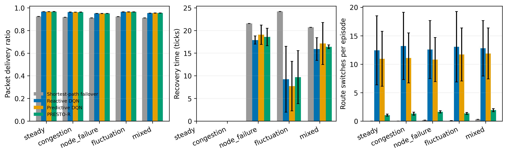

# PRESTO-R: Predictive, Stability-Aware Reinforcement Learning Routing

## Abstract

This report evaluates risk-aware routing with a GRU link-degradation predictor and a switch-penalized DQN policy. Results are from the repository's simulated network environment; they are not evidence of deployment performance on production networks. All reported metrics and tables below are generated from saved test episodes and resolved configurations.

## 1. Introduction

Routing policies must balance delivery and recovery against the instability caused by frequent path changes. PRESTO-R augments per-path observations with predicted link risk and adds a penalty for switching. The project evaluates whether this combination improves routing behavior over a reactive DQN, a predictive policy without the selected switch penalty, and a shortest-path failover baseline.

## 2. Related work and scope

The experimental comparisons are internal baselines implemented in this repository. The project does not claim a reproduction of an external RQSMR implementation. Its predictor is trained on simulator-derived telemetry, and failures are synthetic. Claims in this report are limited to the tested simulator and seed ranges.

## 3. System design

The simulator supplies noisy telemetry and route outcomes. A GRU estimates link degradation risk over horizon H; the DQN policy observes path features and risk features. Its reward includes the selected switch penalty λ. Heuristic and learned policies use a common deterministic rollout and metric pipeline.

## 4. Experimental setup

The main held-out grid uses five scenarios and two topologies. NSFNET learned agents use five training seeds; RGG agents use three. The common test-seed range and configuration-derived parameters are shown below. PDR is delivered traffic divided by offered demand; recovery time, proactive rate, and route switches are computed per episode. Across-seed standard deviations describe training-seed variation; paired tests use matched held-out scenario seeds with Holm correction.

### T1. Simulation and training parameters

| Parameter | Value |
| --- | --- |
| Primary topology | NSFNET |
| Episode length (ticks) | 200 |
| Link capacity / base-delay range (ms) | 10.0 / [2, 12] |
| Candidate paths | 4 |
| Predictor window W / horizon H | 10 / 5 |
| Switch penalty λ | 0.5 |
| Agent training steps | 300000 |
| Training seeds | 0–4 (NSFNET); 0–2 (RGG) |
| Held-out test seeds | 10000–10199 |
| Scenarios | steady, congestion, node_failure, fluctuation, mixed |

## 5. Results

### 5.1 Predictor quality

The precision-recall panel is restricted to onset samples. Calibration uses the held-out predictor test split. The table distinguishes onset from all samples and includes predictor subgroup rows when available.

### T2. Held-out predictor metrics

| model | subset | group | f1 | pr_auc | brier | median_lead_time | samples |
| --- | --- | --- | --- | --- | --- | --- | --- |
| gru | all | all | 0.9769 | 0.9861 | 0.0054 | 3.0 | 822705 |
| gru | onset | all | 0.5296 | 0.4945 | 0.0054 | 3.0 | 769718 |
| gru | onset | failure:precursor | 0.7476 | 0.8639 | 0.3343 | — | 1256 |
| gru | onset | failure:sudden | 0.6667 | 0.5388 | 0.4615 | — | 240 |
| logreg | all | all | 0.9699 | 0.9836 | 0.0075 | 1.0 | 822705 |
| logreg | onset | all | 0.3949 | 0.2656 | 0.0075 | 2.0 | 769718 |
| logreg | onset | failure:precursor | 0.7534 | 0.8022 | 0.3566 | — | 1256 |
| logreg | onset | failure:sudden | 0.661 | 0.5348 | 0.4516 | — | 240 |

The risk trace is a deterministic illustrative mixed-scenario episode, not an aggregate score.

### 5.2 Main comparison

On NSFNET mixed test episodes, PRESTO-R averaged 5.20 switches per episode versus 20.99 for Predictive DQN (75.2% fewer) and its PDR was 0.9625 versus 0.9608 (difference +0.0017). These values average episode metrics within each training seed before averaging across training seeds.

Bars show the mean across training-seed episode averages; error bars are standard deviations across training seeds. The deterministic heuristic has no between-training-seed variation.

#### T3. NSFNET test results (mean ± standard deviation over training seeds)

| Method | Scenario | pdr | delay_mean | recovery_time | switches | proactive_rate | unnecessary_switch_rate |
| --- | --- | --- | --- | --- | --- | --- | --- |
| sp_failover | steady | 0.8966 ± NA | 119.9542 ± NA | not available | 0.0000 ± NA | not available | not available |
| sp_failover | congestion | 0.8747 ± NA | 128.1184 ± NA | not available | 0.0000 ± NA | not available | not available |
| sp_failover | node_failure | 0.8871 ± NA | 117.6611 ± NA | 21.5272 ± NA | 0.3100 ± NA | 0.0068 ± NA | 0.0000 ± NA |
| sp_failover | fluctuation | 0.8875 ± NA | 124.2878 ± NA | 18.8750 ± NA | 0.0700 ± NA | 0.0000 ± NA | 0.0000 ± NA |
| sp_failover | mixed | 0.8751 ± NA | 126.5853 ± NA | 22.8085 ± NA | 0.2650 ± NA | 0.0000 ± NA | 0.0000 ± NA |
| reactive_dqn | steady | 0.9797 ± 0.0009 | 46.3062 ± 0.7003 | not available | 20.0070 ± 1.9388 | not available | 0.4127 ± 0.0349 |
| reactive_dqn | congestion | 0.9721 ± 0.0009 | 52.6087 ± 0.6362 | not available | 19.9130 ± 2.0395 | not available | 0.3818 ± 0.0225 |
| reactive_dqn | node_failure | 0.9662 ± 0.0010 | 52.6682 ± 0.8414 | 8.8951 ± 1.1546 | 19.1490 ± 1.9134 | 0.5070 ± 0.0331 | 0.3675 ± 0.0284 |
| reactive_dqn | fluctuation | 0.9740 ± 0.0011 | 49.7406 ± 0.6025 | 7.4906 ± 2.5128 | 20.1760 ± 1.9200 | 0.2886 ± 0.0470 | 0.3907 ± 0.0245 |
| reactive_dqn | mixed | 0.9619 ± 0.0008 | 56.6613 ± 0.7133 | 7.7741 ± 0.3258 | 18.7990 ± 1.4575 | 0.4572 ± 0.0339 | 0.3444 ± 0.0279 |
| predictive_dqn | steady | 0.9786 ± 0.0008 | 46.7965 ± 1.5823 | not available | 23.0240 ± 6.5355 | not available | 0.4975 ± 0.0390 |
| predictive_dqn | congestion | 0.9708 ± 0.0010 | 53.0682 ± 1.4765 | not available | 23.0640 ± 6.0548 | not available | 0.4524 ± 0.0247 |
| predictive_dqn | node_failure | 0.9652 ± 0.0013 | 53.4841 ± 1.3807 | 7.6455 ± 1.3806 | 21.4570 ± 5.5372 | 0.5872 ± 0.0444 | 0.4429 ± 0.0200 |
| predictive_dqn | fluctuation | 0.9726 ± 0.0011 | 50.7261 ± 1.6293 | 11.6746 ± 5.3045 | 23.4190 ± 5.6024 | 0.2294 ± 0.0928 | 0.4656 ± 0.0215 |
| predictive_dqn | mixed | 0.9608 ± 0.0013 | 57.1976 ± 0.9776 | 8.0037 ± 0.3307 | 20.9880 ± 5.2802 | 0.5108 ± 0.0578 | 0.4128 ± 0.0342 |
| presto_dqn | steady | 0.9804 ± 0.0007 | 46.2766 ± 1.0454 | not available | 5.2120 ± 1.8193 | not available | 0.2836 ± 0.0585 |
| presto_dqn | congestion | 0.9729 ± 0.0006 | 52.4105 ± 0.8563 | not available | 5.4780 ± 1.8468 | not available | 0.2794 ± 0.0614 |
| presto_dqn | node_failure | 0.9667 ± 0.0007 | 52.5669 ± 0.8969 | 9.4236 ± 1.5982 | 5.1820 ± 1.6214 | 0.4472 ± 0.0426 | 0.2412 ± 0.0500 |
| presto_dqn | fluctuation | 0.9749 ± 0.0007 | 49.8912 ± 1.1183 | 7.9852 ± 1.7305 | 5.5570 ± 1.7518 | 0.2418 ± 0.0564 | 0.2766 ± 0.0575 |
| presto_dqn | mixed | 0.9625 ± 0.0005 | 56.3287 ± 0.9610 | 8.8419 ± 0.6810 | 5.1970 ± 1.6276 | 0.3901 ± 0.0524 | 0.2344 ± 0.0494 |

#### T4. Paired PRESTO-R comparisons on NSFNET

| scenario | metric | baseline | n_episodes | median_difference | p_holm | effect_size_r |
| --- | --- | --- | --- | --- | --- | --- |
| congestion | pdr | predictive_dqn | 200 | 3.989e-06 | 8.57e-10 | 0.482 |
| congestion | pdr | reactive_dqn | 200 | 0 | 0.914 | 0.000 |
| congestion | switches | predictive_dqn | 200 | -7.8 | 8.38e-22 | -0.713 |
| congestion | switches | reactive_dqn | 200 | -4.7 | 1.63e-20 | -0.691 |
| fluctuation | pdr | predictive_dqn | 200 | 2.4945e-06 | 1.47e-06 | 0.399 |
| fluctuation | pdr | reactive_dqn | 200 | 0 | 0.0104 | 0.000 |
| fluctuation | recovery_time | predictive_dqn | 16 | 0 | 1 | 0.000 |
| fluctuation | recovery_time | reactive_dqn | 18 | 0 | 1 | 0.000 |
| fluctuation | switches | predictive_dqn | 200 | -8.9 | 8.86e-23 | -0.728 |
| fluctuation | switches | reactive_dqn | 200 | -4.1 | 3.05e-21 | -0.704 |
| mixed | pdr | predictive_dqn | 200 | 2.302e-05 | 4.77e-05 | 0.354 |
| mixed | pdr | reactive_dqn | 200 | 0 | 0.616 | 0.000 |
| mixed | recovery_time | predictive_dqn | 58 | 0 | 1 | 0.000 |
| mixed | recovery_time | reactive_dqn | 59 | 0 | 0.472 | 0.000 |
| mixed | switches | predictive_dqn | 200 | -8.1 | 1.2e-25 | -0.772 |
| mixed | switches | reactive_dqn | 200 | -6.3 | 1.15e-23 | -0.742 |
| node_failure | pdr | predictive_dqn | 200 | 5.4865e-06 | 0.00154 | 0.301 |
| node_failure | pdr | reactive_dqn | 200 | 0 | 1 | 0.000 |
| node_failure | recovery_time | predictive_dqn | 53 | 0 | 0.0493 | 0.000 |
| node_failure | recovery_time | reactive_dqn | 51 | 0 | 0.262 | 0.000 |
| node_failure | switches | predictive_dqn | 200 | -8 | 2.02e-23 | -0.739 |
| node_failure | switches | reactive_dqn | 200 | -6.2 | 3.41e-22 | -0.719 |
| steady | pdr | predictive_dqn | 200 | 0 | 3.52e-08 | 0.000 |
| steady | pdr | reactive_dqn | 200 | 0 | 0.341 | 0.000 |
| steady | switches | predictive_dqn | 200 | -4.1 | 9.87e-19 | -0.661 |
| steady | switches | reactive_dqn | 200 | -2.2 | 2.21e-17 | -0.637 |

### 5.3 Prediction and switch-penalty ablation

The λ curve uses mixed-scenario test episodes for the validation-screened penalty variants. The full 2×2 factorial is not available because the no-prediction/penalty (`reactive_dqn_pen`) cell was not part of the completed P0 test grid; it is explicitly marked rather than inferred.

#### T5. Available mixed-scenario ablation cells

| Ablation | Method | PDR (mean over seeds) | Switches / episode (mean over seeds) |
| --- | --- | --- | --- |
| No prediction; no penalty | reactive_dqn | 0.9619 | 18.799 |
| Prediction; no penalty | presto_lam0 | 0.9628 | 17.812 |
| Prediction; selected penalty | presto_dqn | 0.9625 | 5.197 |
| No prediction; selected penalty | reactive_dqn_pen | not run in the completed P0 grid | not run in the completed P0 grid |

### 5.4 Behavior around failures

The event trace shows the first suitable held-out test episode found among the first 20 test seeds. It is illustrative and should be interpreted alongside the per-episode statistics, not as a representative estimate.

### 5.5 Sensitivity to horizon and switch penalty

Horizon-specific agents are evaluated on mixed and node-failure test scenarios; predictor F1 is measured on the corresponding held-out predictor data. The λ sweep is shown in F5.

#### Horizon-sweep results

| horizon | scenario | pdr_mean | pdr_std | switches_mean | switches_std | proactive_rate_mean | proactive_rate_std | recovery_time_mean | recovery_time_std | predictor_onset_f1 |
| --- | --- | --- | --- | --- | --- | --- | --- | --- | --- | --- |
| 3 | mixed | 0.9613 | 0.0016 | 6.8733 | 2.0496 | 0.3463 | 0.0653 | 9.7458 | 0.3708 | 0.5992 |
| 3 | node_failure | 0.9661 | 0.0017 | 6.675 | 1.9609 | 0.4783 | 0.0352 | 9.3308 | 1.8138 | 0.5992 |
| 10 | mixed | 0.9616 | 0.0015 | 5.5583 | 1.8525 | 0.3912 | 0.0171 | 8.8698 | 0.4399 | 0.4734 |
| 10 | node_failure | 0.9658 | 0.0019 | 5.8983 | 2.2085 | 0.5459 | 0.0096 | 9.2278 | 1.1084 | 0.4734 |

### 5.6 Second topology and robustness

#### RGG test results

| Method | Scenario | pdr | delay_mean | recovery_time | switches | proactive_rate | unnecessary_switch_rate |
| --- | --- | --- | --- | --- | --- | --- | --- |
| sp_failover | steady | 0.9242 ± NA | 68.3566 ± NA | not available | 0.0000 ± NA | not available | not available |
| sp_failover | congestion | 0.9170 ± NA | 70.6413 ± NA | not available | 0.0000 ± NA | not available | not available |
| sp_failover | node_failure | 0.9116 ± NA | 68.4587 ± NA | 21.5526 ± NA | 0.1550 ± NA | 0.0000 ± NA | 0.0000 ± NA |
| sp_failover | fluctuation | 0.9230 ± NA | 68.1102 ± NA | 24.1667 ± NA | 0.0650 ± NA | 0.0000 ± NA | 0.0000 ± NA |
| sp_failover | mixed | 0.9108 ± NA | 71.3116 ± NA | 20.6959 ± NA | 0.2850 ± NA | 0.0058 ± NA | 0.0000 ± NA |
| reactive_dqn | steady | 0.9665 ± 0.0003 | 34.6919 ± 0.3298 | not available | 12.4383 ± 6.0721 | not available | 0.6090 ± 0.1239 |
| reactive_dqn | congestion | 0.9625 ± 0.0003 | 35.6699 ± 0.3392 | not available | 13.1983 ± 5.9101 | not available | 0.6268 ± 0.0945 |
| reactive_dqn | node_failure | 0.9505 ± 0.0003 | 36.8101 ± 0.2686 | 17.8846 ± 0.9031 | 12.5583 ± 5.1001 | 0.3853 ± 0.0151 | 0.6007 ± 0.0860 |
| reactive_dqn | fluctuation | 0.9643 ± 0.0004 | 35.6269 ± 0.4518 | 9.2333 ± 7.2590 | 13.0617 ± 6.1823 | 0.0667 ± 0.0577 | 0.5861 ± 0.0971 |
| reactive_dqn | mixed | 0.9542 ± 0.0002 | 37.9024 ± 0.3205 | 15.8897 ± 2.5097 | 12.7883 ± 4.8685 | 0.3438 ± 0.0343 | 0.5656 ± 0.0596 |
| predictive_dqn | steady | 0.9664 ± 0.0004 | 35.2924 ± 0.4202 | not available | 10.9417 ± 4.8419 | not available | 0.6496 ± 0.1253 |
| predictive_dqn | congestion | 0.9625 ± 0.0002 | 36.3546 ± 0.6216 | not available | 11.0900 ± 4.4003 | not available | 0.6616 ± 0.0919 |
| predictive_dqn | node_failure | 0.9504 ± 0.0003 | 37.2256 ± 0.2825 | 19.0515 ± 2.1342 | 10.8100 ± 3.8714 | 0.3817 ± 0.0398 | 0.6129 ± 0.1033 |
| predictive_dqn | fluctuation | 0.9647 ± 0.0005 | 36.0663 ± 0.3574 | 7.7180 ± 5.4765 | 11.7017 ± 4.6742 | 0.2968 ± 0.0847 | 0.6378 ± 0.0972 |
| predictive_dqn | mixed | 0.9546 ± 0.0007 | 38.4670 ± 0.3982 | 17.1224 ± 4.6365 | 11.8733 ± 4.4776 | 0.4826 ± 0.1154 | 0.6037 ± 0.0747 |
| presto_dqn | steady | 0.9669 ± 0.0003 | 34.4730 ± 1.4464 | not available | 1.0383 ± 0.1922 | not available | 0.3146 ± 0.0184 |
| presto_dqn | congestion | 0.9627 ± 0.0005 | 35.5245 ± 1.5505 | not available | 1.3033 ± 0.2642 | not available | 0.3733 ± 0.0195 |
| presto_dqn | node_failure | 0.9508 ± 0.0004 | 36.5316 ± 1.0023 | 18.5616 ± 1.9305 | 1.6250 ± 0.1922 | 0.3607 ± 0.0478 | 0.2928 ± 0.0337 |
| presto_dqn | fluctuation | 0.9647 ± 0.0005 | 35.5024 ± 1.6147 | 9.6881 ± 5.8649 | 1.3267 ± 0.1692 | 0.0859 ± 0.0834 | 0.3274 ± 0.0148 |
| presto_dqn | mixed | 0.9545 ± 0.0010 | 38.1368 ± 1.9417 | 16.3996 ± 0.3937 | 1.9133 ± 0.2644 | 0.4159 ± 0.0706 | 0.2932 ± 0.0256 |

#### T6. Evaluation-only robustness checks

| case | method | metric | mean_over_training_seeds | std_over_training_seeds | training_seeds |
| --- | --- | --- | --- | --- | --- |
| sudden | reactive_sudden | pdr | 0.9619 | 0.0008 | 5 |
| sudden | reactive_sudden | switches | 18.799 | 1.4575 | 5 |
| sudden | reactive_sudden | recovery_time | 7.7741 | 0.3258 | 5 |
| sudden | reactive_sudden | proactive_rate | 0.4572 | 0.0339 | 5 |
| sudden | presto_sudden | pdr | 0.9625 | 0.0005 | 5 |
| sudden | presto_sudden | switches | 5.197 | 1.6276 | 5 |
| sudden | presto_sudden | recovery_time | 8.8419 | 0.681 | 5 |
| sudden | presto_sudden | proactive_rate | 0.3901 | 0.0524 | 5 |
| noise2x | reactive_noise2x | pdr | 0.9618 | 0.0007 | 5 |
| noise2x | reactive_noise2x | switches | 19.916 | 1.3194 | 5 |
| noise2x | reactive_noise2x | recovery_time | 8.0025 | 0.471 | 5 |
| noise2x | reactive_noise2x | proactive_rate | 0.4418 | 0.0494 | 5 |
| noise2x | presto_noise2x | pdr | 0.9626 | 0.0005 | 5 |
| noise2x | presto_noise2x | switches | 5.582 | 1.6968 | 5 |
| noise2x | presto_noise2x | recovery_time | 9.0004 | 0.8428 | 5 |
| noise2x | presto_noise2x | proactive_rate | 0.3994 | 0.0599 | 5 |
| load150 | reactive_load150 | pdr | 0.8728 | 0.001 | 5 |
| load150 | reactive_load150 | switches | 18.846 | 2.1709 | 5 |
| load150 | reactive_load150 | recovery_time | 16.1781 | 0.2633 | 5 |
| load150 | reactive_load150 | proactive_rate | 0.4341 | 0.0262 | 5 |
| load150 | presto_load150 | pdr | 0.8736 | 0.0013 | 5 |
| load150 | presto_load150 | switches | 4.985 | 1.8631 | 5 |
| load150 | presto_load150 | recovery_time | 17.038 | 1.9265 | 5 |
| load150 | presto_load150 | proactive_rate | 0.3972 | 0.0388 | 5 |

Sudden failures remove precursor warning; noise and background-load changes are applied only at evaluation. No robustness condition is used for retraining or test-based tuning.

### Mixed-scenario λ sensitivity data

| lambda | method | pdr_mean | pdr_std | switches_mean | switches_std | unnecessary_switch_rate_mean | unnecessary_switch_rate_std | recovery_time_mean | recovery_time_std | proactive_rate_mean | proactive_rate_std |
| --- | --- | --- | --- | --- | --- | --- | --- | --- | --- | --- | --- |
| 0.0 | presto_lam0 | 0.9628 | 0.0697 | 17.8125 | 25.7984 | 0.376 | 0.3446 | 7.5033 | 12.9154 | 0.5248 | 0.4769 |
| 0.05 | presto_lam005 | 0.9623 | 0.071 | 14.8125 | 24.591 | 0.3562 | 0.3407 | 9.2273 | 14.1703 | 0.4327 | 0.4773 |
| 0.1 | presto_lam01 | 0.9624 | 0.0705 | 10.7475 | 17.7226 | 0.3167 | 0.3147 | 8.5316 | 13.8551 | 0.4509 | 0.4819 |
| 0.25 | presto_lam025 | 0.9627 | 0.0703 | 6.8725 | 12.9127 | 0.2486 | 0.288 | 9.3152 | 14.5388 | 0.4239 | 0.4723 |
| 0.5 | presto_lam05 | 0.9619 | 0.0725 | 5.3625 | 9.5133 | 0.2585 | 0.2963 | 8.6821 | 13.8873 | 0.378 | 0.4662 |

## 6. Discussion and limitations

Results describe a fluid simulator rather than packet-level network behavior. The setup controls one managed flow and uses synthetic failures with designed precursor behavior. The predictor is trained on telemetry generated under the simulator's failover policy, which can limit transfer to other policies or networks. The sudden-failure check is especially important because such events cannot be anticipated from precursor signals. The no-prediction/penalty factorial ablation is missing, and the report does not treat the available partial ablation as a complete causal decomposition.

## 7. Conclusion and future work

PRESTO-R combines risk features with a switching cost; the outcomes and failed criteria are reported without suppressing negative comparisons. Further validation should add multiple managed flows, multipath splitting, packet-level or real-network traces, and online predictor updates. NS-3 validation remains optional Phase 7 work and is not included here.

## 8. Success criteria

### T7. Predeclared criteria

| Check | Result | Details |
|---|---|---|
| PRESTO-R vs reactive in node_failure | FAIL | PDR 0.9667 vs 0.9662; recovery 9.440 vs 8.915; Holm p PDR=1, recovery=0.2617 |
| PRESTO-R vs reactive in fluctuation | FAIL | PDR 0.9749 vs 0.9740; recovery 7.844 vs 7.386; Holm p PDR=0.01042, recovery=1 |
| PRESTO-R vs predictive in mixed | PASS | switches 5.197 vs 20.988; PDR 0.9625 vs 0.9608 |
| PRESTO-R vs predictive in fluctuation | PASS | switches 5.557 vs 23.419; PDR 0.9749 vs 0.9726 |
| Steady-state delay | PASS | PRESTO-R delay 46.2766; limit 50.9369 (reactive × 1.10) |
| Predictor onset F1 | FAIL | GRU validation onset F1=0.5296; threshold=0.7000 |
| Reproducibility | PASS | Step and event parquet hashes match on a fresh rerun |

## Reproducibility

From the repository root, install the pinned dependencies, then run `make quick` for a smoke validation. With the completed raw Phase 5 results present, `make tables`, `make figures`, and `make report` regenerate the derived outputs. All full-grid runs can be resumed with the Phase 5 commands in the README. Test outputs must not be used to retune models or thresholds.
